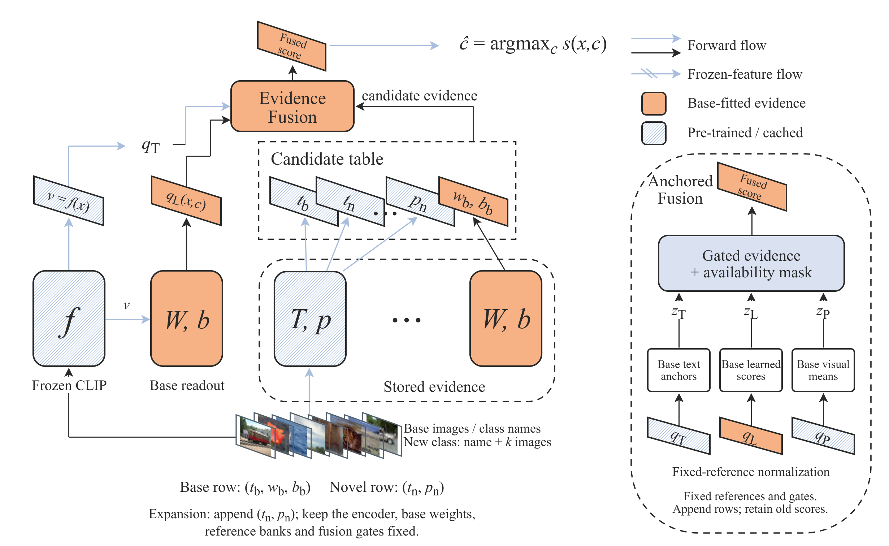

# Reference-Anchored Candidate Tables

Research code and manuscript for **Reference-anchored candidate tables for class
expansion in long-tailed recognition**.

**Junyi Zhang, Shandong University**  
Contact: cheerssom0876@gmail.com

This repository accompanies a research manuscript. No journal acceptance is claimed.

## Method

Each class carries the evidence available to it: a text anchor, a base-trained
classifier column, or a few-shot visual prototype. Fixed base reference banks
normalize each branch independently of the growing candidate vocabulary.
Appending a row preserves existing scores in real arithmetic under fixed
evidence, encoder, references and gates. New classes compete through new scores.



- [Manuscript PDF](paper/fcs/main.pdf)
- [Editable architecture](paper/fcs/figures/fig1_framework_fcs.drawio)
- [Three-slide highlights](paper/fcs/highlights_revised.pptx)

## Recorded five-shot results

Frozen CLIP ViT-L/14; mean accuracy percentages across three distinct class
partitions. Complete partition sample standard deviations and all baseline
results are in the manuscript and CSV files.

| Dataset | Readout | Base | Novel |
|---|---|---:|---:|
| CIFAR-100 | Reference-anchored table | 86.03 | 66.90 |
| CIFAR-100 | Anchored text + prototypes | 82.40 | 76.19 |
| Oxford-IIIT Pets | Reference-anchored table | 97.18 | 87.79 |
| Oxford-IIIT Pets | Anchored text + prototypes | 94.58 | 90.38 |

The table provides a retention-oriented operating point. Fixed-reference dense
text–prototype fusion also shares the score invariant. Both group accuracies
are reported; aggregate accuracy leadership is not a claim of this work.

## Install and prepare public assets

Python 3.10+ is recommended. The exact locally tested package versions are in
`tested_environment.json`; install a PyTorch build appropriate for your machine.

```bash
python -m pip install -r requirements.txt
python -c "from torchvision.datasets import CIFAR100; CIFAR100(root='data', train=True, download=True); CIFAR100(root='data', train=False, download=True)"
python -c "from transformers import CLIPModel, CLIPTokenizer; CLIPModel.from_pretrained('openai/clip-vit-large-patch14'); CLIPTokenizer.from_pretrained('openai/clip-vit-large-patch14')"
```

Run commands from the repository root. The default data directory is `data/`;
override it with `JLT_DATA` if necessary. Oxford-IIIT Pets is downloaded from its
official source by the loader. Dataset images and model weights are not stored
in this repository. Checkpoints must be downloaded before the Pets loader,
which uses the local Hugging Face cache. Feature extraction is GPU-intensive;
the recorded experiments used an RTX 4070 Laptop GPU.

## Protocol checks and experiments

```bash
python src/experiments/test_fcs_protocol.py
python src/experiments/fcs_expansion.py
python src/experiments/fcs_expansion.py --dataset pets
python src/experiments/fcs_review_experiments.py --dataset cifar
python src/experiments/fcs_review_experiments.py --dataset pets
```

Running experiments overwrites their result directories. Preserve a checkout of
the released JSON/snapshots to compare a rerun. If the CIFAR frozen cache is
absent, the primary runner builds it from frozen CLIP without a LoRA checkpoint.
Run each primary dataset experiment before its supplemental controls.

Base classifier fitting, ridge selection and gate calibration use base classes
only. Actual novel classes supply their names and reserved support images.
At five shots all five reserved images are used; support seeds are not
independent repetitions. Statistics average subsets within each class partition
and use the three distinct partitions as independent units.

`experiments/fcs*/review_controls/` contains offset-calibrated controls, 95%/99%
validation retention targets, five-session arrival tests and a frozen
2000-dimensional RanPAC-style analytic adaptation. The latter uses base
validation rather than original within-task MSE selection; it is not a full
reproduction of published RanPAC. Validation targets do not constrain test
retention. Infeasible validation partitions are explicitly flagged.

## Regenerate tables and compile the paper

Regenerate directly from the released records without downloading any data:

```bash
python paper/fcs/build_results.py
python paper/fcs/build_review_results.py
cd paper/fcs
latexmk -pdf -interaction=nonstopmode -halt-on-error main.tex
```

The original run source snapshots and hashes remain in the result directories.
The public copy of `src/config.py` replaces machine-specific default paths with
paths relative to this checkout; experimental source snapshots are unchanged.
Supporting legacy modules are included because the runner imports their dataset
split helper; the commands above are the FCS evaluation entry points.

## Availability

Datasets and pretrained weights retain their original licenses. The repository
contains implementation, manuscript, editable figure, numeric records and small
prediction archives. Downloaded third-party papers, local model/feature caches,
and internal editorial reports are excluded.
